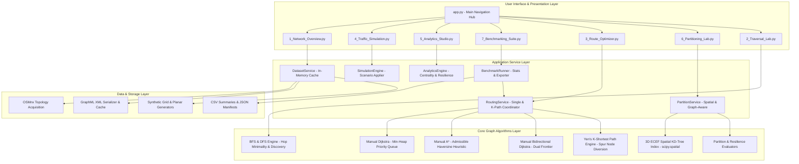
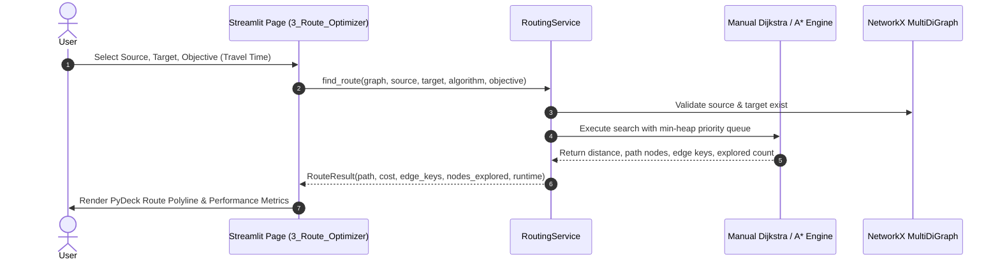

# System Architecture Documentation

**Product:** SmartRoute Analytics  
**Academic Title:** Intelligent Emergency Vehicle Routing and Urban Road Network Resilience Analysis Using Large-Scale Graph Algorithms  
**Project Root:** `LSGA PBL`  

---

## 1. Architectural Philosophy & Design Principles

SmartRoute Analytics is engineered as a high-performance, modular, in-memory graph analytics system designed specifically for deterministic, reproducible algorithmic experimentation on urban street networks.

The system is structured according to clear architectural invariants:
1. **Separation of Concerns:** Algorithmic routing engines are decoupled from data ingestion, scenario manipulation, and Streamlit presentation.
2. **Graph Immutability:** The base topological road network $G = (V, E)$ is strictly immutable. All dynamic simulation effects (traffic congestion multipliers and road closures) operate on transient scenario overlays or isolated deep-copies.
3. **Directed MultiDiGraph Fidelity:** The network preserves real-world road geometries, one-way restrictions, and multi-lane/parallel road segments using integer edge keys $k \in \mathbb{N}_0$.
4. **Deterministic Reproducibility:** All pseudo-random processes (synthetic grid generation, congestion assignment, percolation failure sequences, benchmark query generation) adhere to explicit seed-locking.
5. **Zero External Runtime Infrastructure:** Operates locally on Windows without requiring relational databases, Redis queues, external routing daemons, or cloud API keys.

---

## 2. High-Level System Architecture Diagram

---

## 3. Subsystem Breakdown

### 3.1 Data Acquisition & Storage Subsystem (`src/graph/`)
- **`graph_loader.py`**: Fetches road networks using `osmnx.graph_from_place` or `graph_from_bbox` and converts them into `networkx.MultiDiGraph`.
- **`storage.py`**: Serializes and deserializes network topologies into standardized GraphML format with custom attribute converters for node coordinates (`y`, `x`), lengths (`length_m`), speeds (`speed_kph`), and travel times (`travel_time_s`).
- **`validation.py`**: Enforces invariant checks: non-emptiness, directedness, presence of spatial coordinates, and non-negative finite travel times.
- **`dataset_sampler.py`**: Provides deterministic synthetic network generation (`4x4` and `NxM` grids, random planar networks) for offline benchmarks.

### 3.2 Routing & Shortest-Path Engine (`src/routing/` & `src/algorithms/`)
- **`dijkstra.py`**: Custom implementation of Dijkstra's algorithm using Python's `heapq` min-heap. Tracks node distances $d[v]$, parent pointers $\pi[v]$, edge keys, and settled node counters.
- **`astar.py`**: Custom A* search incorporating an admissible and consistent Haversine distance heuristic divided by the maximum speed $v_{\max} = 33.33\text{ m/s}$ (120 km/h).
- **`bidirectional_dijkstra.py`**: Dual-frontier search advancing forward from source $s$ and backward along reversed directed edges from target $t$, terminating when $\min(d_f) + \min(d_b) \ge \mu$.
- **`route_alternatives.py`**: Yen's algorithm finding $K$ loopless paths by iteratively deviating from root subpaths at spur nodes with temporary structural edge exclusions.

### 3.3 Dynamic Simulation Subsystem (`src/simulation/`)
- **`scenario_builder.py`**: Generates scenario models defining edge congestion factors and list of blocked nodes/edges.
- **`simulation_engine.py`**: Constructs a transient active graph $G_s = (V \setminus V_{\text{blocked}}, E \setminus E_{\text{closed}})$ with adjusted edge traversal times:
  $$T_s(e) = T(e) \cdot (1 + \text{congestion\_factor})$$
  Ensures the underlying baseline road graph is never mutated.

### 3.4 Graph Analytics & Resilience Subsystem (`src/analytics/`)
- **`centrality.py`**: Computes degree, betweenness, closeness, and PageRank centralities. Supports randomized k-node sampling for betweenness on large graphs ($V > 1000$).
- **`connectivity.py`**: Evaluates Tarjan's Strongly Connected Components (SCC) and Weakly Connected Components (WCC).
- **`resilience.py`**: Simulates site percolation under targeted removal (ranked by betweenness centrality) versus uniform random removal, tracking the relative size of the Giant Strongly Connected Component.
- **`mst.py`**: Projects directed road networks into an undirected symmetric graph and extracts the Minimum Spanning Forest (MSF) via Kruskal's / Prim's algorithm.

### 3.5 Graph Partitioning & Spatial Indexing (`src/partitioning/` & `src/indexing/`)
- **`geographic.py`**: Implements recursive geographic bisection using node coordinate medians (latitude/longitude split).
- **`graph_aware.py`**: Implements balanced region-growing partitioning using multi-source BFS starting from geographically dispersed seed nodes.
- **`spatial_index.py`**: Projects geodetic coordinates $(\phi, \lambda)$ into 3D Earth-Centered Earth-Fixed (ECEF) Cartesian coordinates:
  $$X = R \cos \phi \cos \lambda, \quad Y = R \cos \phi \sin \lambda, \quad Z = R \sin \phi$$
  Constructs a `scipy.spatial.cKDTree` supporting $O(\log |V|)$ nearest-intersection lookups.

### 3.6 Benchmarking & Experimentation Subsystem (`src/benchmarks/`)
- **`query_generator.py`**: Generates deterministic, connected source-target query pairs using fixed seeds.
- **`runner.py`**: Manages execution warm-up, microsecond-accurate timing (`time.perf_counter`), memory tracking (`tracemalloc`), node expansion counting, and correctness validation against NetworkX reference paths.
- **`report_export.py`**: Exports raw iteration logs, aggregated statistics, and JSON reproducibility manifests into `results/benchmarks/`.

---

## 4. Architectural Invariants & Data Flow

