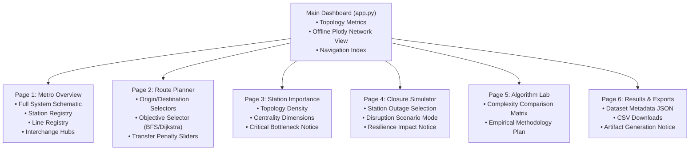

# MetroGraph Analytics: Application User Flow & Page Hierarchy

## 1. Application Navigation Map

## 2. Page Interaction Specifications

### Main Dashboard (`app.py`)
- **Header**: Title, academic metadata, and Phase 1 Foundation badge.
- **Metrics Bar**: Total Stations, Total Lines, Total Connections, Interchange Stations.
- **Schematic Visualization**: Interactive Plotly graph rendering stations and colored line links.
- **Sidebar**: Global parameters, active city context, and development phase progression indicator.

### Page 1: Metro Overview (`pages/1_Metro_Overview.py`)
- High-level topology breakdown and single connected component validation.
- Interactive multi-tab data explorer (Stations, Lines, Connections, and Interchange Hubs).

### Page 2: Route Planner (`pages/2_Route_Planner.py`)
- Dropdowns populated dynamically from verified station registries.
- Multi-criteria selector (Minimum Stops, Shortest Time, Minimum Transfers).
- Phase 3/4 integration notice.

### Page 3: Station Importance (`pages/3_Station_Importance.py`)
- Hub density and structural statistics.
- Academic breakdown of Degree, Betweenness, and Closeness centrality algorithms.
- Phase 5 integration notice.

### Page 4: Closure Simulator (`pages/4_Closure_Simulator.py`)
- Interactive station outage simulator selector.
- Scenario trigger for maintenance, signal failure, or overcrowding.
- Phase 6 resilience engine notice.

### Page 5: Algorithm Lab (`pages/5_Algorithm_Lab.py`)
- Theoretical vs empirical evaluation framework.
- Complexity matrix covering Big-O time and space bounds for all target algorithms.

### Page 6: Results & Exports (`pages/6_Results.py`)
- Real-time JSON manifest of verified system state.
- One-click downloads for raw verified datasets (stations.csv, lines.csv, connections.csv).
