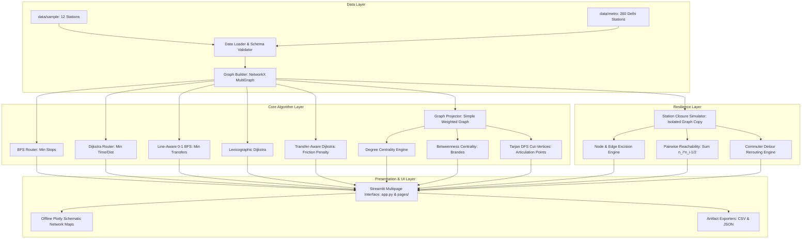

# System Architecture & Technical Specification

## 1. High-Level Architecture Overview

**MetroGraph Analytics** is built on a modular, decoupled Python architecture where graph-theoretic calculation engines operate independently of the presentation and visualization layers.

---

## 2. Component Descriptions

### A. Data Layer (`src/data/`, `src/graph/`)
- **Loader & Validator:** Verifies CSV relational integrity across stations, lines, connections, and memberships.
- **Metro Builder:** Generates an undirected `networkx.MultiGraph` preserving parallel line operations along shared physical track corridors.

### B. Routing Engines (`src/algorithms/`)
- **BFS:** Explores station nodes level-by-level in $\mathcal{O}(|V| + |E|)$.
- **Dijkstra:** Priority-queue based path cost minimization in $\mathcal{O}((|V| + |E|) \log |V|)$.
- **Line-Aware State Graph:** Expands states to $(u, \ell) \in V \times L$ where track hops cost 0 and line switches cost 1. Solved via deque-based 0-1 BFS in $\mathcal{O}(|L| \cdot (|V| + |E|))$.

### C. Structural Analytics (`src/analytics/`)
- Projects the MultiGraph onto a simple graph where parallel edges collapse into minimum physical travel times.
- Evaluates degree centrality, Brandes unweighted betweenness centrality ($\mathcal{O}(|V||E|)$), and Tarjan DFS cut-vertices ($\mathcal{O}(|V| + |E|)$).

### D. Simulation Engine (`src/simulation/`)
- Guarantees complete immutability via `graph.copy()`.
- Calculates post-outage connected component partitions and computes global reachable pairs $\sum \frac{n_i(n_i-1)}{2}$.
