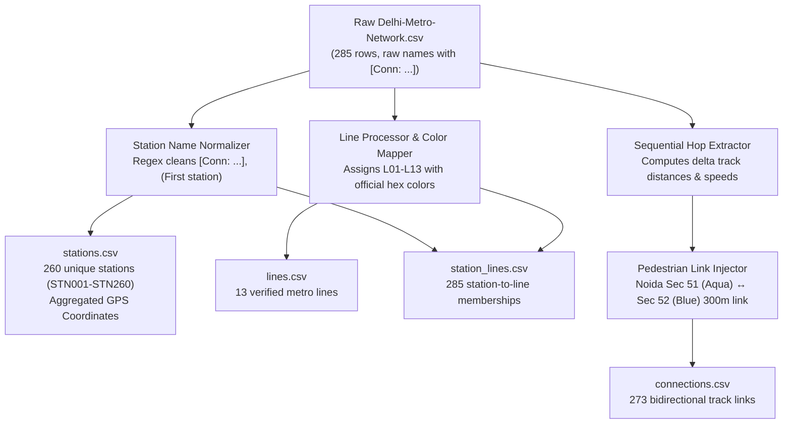

# Delhi Metro Data Pipeline

## 1. Data Ingestion & Provenance
The MetroGraph Analytics Phase 2 data pipeline ingests and normalizes real-world transit network datasets for the Delhi National Capital Region (NCR).

### Data Source Specifications
- **Dataset Name**: Delhi Metro Network Dataset (Normalized)
- **Source Organization**: Delhi Metro Rail Corporation (DMRC) open data via community transit archives.
- **Upstream Repository**: `https://raw.githubusercontent.com/heyamay/Delhi-Metro-Network-Analysis/main/Delhi-Metro-Network.csv`
- **Access Date**: 2026-11-20
- **License**: Open Data Commons Open Database License (ODbL) / Public Community Transit Data
- **Geographic Coverage**: Delhi NCR (Delhi, Noida, Greater Noida, Gurgaon, Ghaziabad, Faridabad)

---

## 2. ETL Processing Workflow

---

## 3. Schema & Data Table Definitions

### `stations.csv`
- `station_id` (str): Unique primary key (`STN001` - `STN260`).
- `station_name` (str): Cleaned human-readable station name.
- `latitude` (float): Geographic latitude in decimal degrees.
- `longitude` (float): Geographic longitude in decimal degrees.

### `lines.csv`
- `line_id` (str): Unique identifier (`L01` - `L13`).
- `line_name` (str): Canonical line name (e.g. `Red line`, `Yellow line`, `Aqua line`).
- `color` (str): Distinct hex color code for visualization.
- `operator` (str): Operating entity (e.g., DMRC, NMRC, Rapid Metro Gurgaon).

### `station_lines.csv`
- `station_id` (str): Foreign key referencing `stations.csv`.
- `line_id` (str): Foreign key referencing `lines.csv`.

### `connections.csv`
- `source_station_id` (str): Origin station ID.
- `destination_station_id` (str): Target adjacent station ID.
- `line_id` (str): Line identifier operating this link.
- `distance_km` (float): Track distance in kilometers.
- `estimated_time_min` (float): Travel duration in minutes.
- `weight_provenance` (str): `published`, `derived`, or `geodesic_distance_km`.

---

## 4. Offline Integrity & Deterministic Hashing
All ingested CSV files are hashed using SHA-256 to create a `fingerprint` stored in `metadata.json`. GraphML caches are invalidated if the fingerprint changes.
